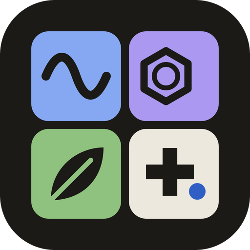

# stay add.

**Stay addicted, keep adding.** A free study site for Cambridge IGCSE science —
Physics, Chemistry and Biology — where every idea is explained in plain words, tried in a
small interactive lab, and finished with the cause → effect chain examiners want.

No sign-up and no build step: your progress is saved only in your own browser.

## How a lesson works

Each topic follows the same three steps, so you always know where you are:

1. **Understand**: short notes with the exam definitions, tables and key terms.
2. **Experiment** (or **Look closely**): change one thing in a lab and read
   “What just happened”, or study a labelled figure.
3. **Interpret**: the cause → effect chains to remember, an exam tip, and an “I can…” checklist.

## What’s inside

| Subject | Syllabus | Live lessons |
|---|---|---|
| Chemistry | 0620 / 0971 | Electrolysis · Collision theory · Naming organic compounds |
| Physics | 0625 / 0972 | Refraction |
| Biology | 0610 / 0970 | All 21 topics: Enzymes and Reproduction / Inheritance with labs; topics 1–4, 6–15, 18–21 as figure lessons |

Some of the labs:
- **Electrolysis:** what forms at each electrode, for molten and dissolved compounds.
- **Naming organic compounds:** build a molecule and get its IUPAC name, worked out in seven steps.
- **Refraction:** aim a laser into water, glass or diamond and read the angles.
- **Enzymes:** temperature and pH change the shape of the active site.
- **The menstrual cycle:** a 28-day hormone timeline.
- **Genetic crosses:** Punnett squares, including blood groups and sex linkage.
- **Mitosis and meiosis:** step through each division.

Also: search across all subjects, light and dark themes, and pages that work on phones.

## Run it

Open `index.html` in a browser, or serve the folder locally:

```bash
python3 -m http.server 5174
```

then visit <http://localhost:5174>. Any static host works, such as GitHub Pages, Netlify or
Cloudflare Pages: upload the folder as it is.

**Install it as an app.** stay add. is a PWA: on a phone or iPad choose *Add to Home Screen*
(Safari: Share → Add to Home Screen), or use the install button in Chrome or Edge. Once it has
opened online, every lesson also works offline. This needs `https://` or `localhost`; it does not
work when `index.html` is opened as a file.

Handy URL options: `?theme=dark` or `?theme=light` forces a theme, and `?still` turns off
animation.

## Project layout

```
index.html        the home page for all subjects
assets/           shared by every page: design system, header, menu, search, lesson form
chemistry/        each subject has: index.html (its home), lessons/, css/, js/
physics/
biology/
```

Every subject, topic and lesson is listed in `assets/js/catalog.js`. Add a lesson there and it
appears in the menu, the search and the subject pages by itself.

See **[DEVELOPING.md](DEVELOPING.md)** for the full folder map, the lesson template, how to
add a lesson or a subject, and the design system.

## Built with

Plain HTML, CSS and JavaScript, with the [Space Grotesk](https://fonts.google.com/specimen/Space+Grotesk),
[IBM Plex Sans](https://fonts.google.com/specimen/IBM+Plex+Sans), [Newsreader](https://fonts.google.com/specimen/Newsreader) and
[IBM Plex Mono](https://fonts.google.com/specimen/IBM+Plex+Mono) fonts from Google Fonts, and
[GSAP](https://gsap.com) for the menu animation.

---

stay add. is an independent study aid and is not affiliated with or endorsed by Cambridge
University Press & Assessment.
